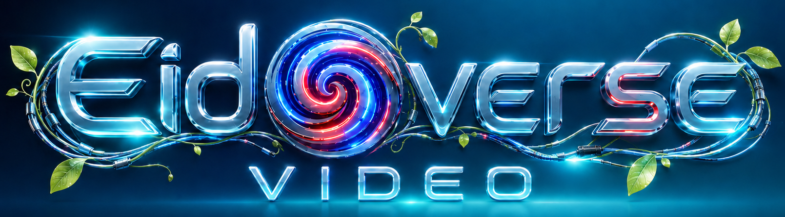

<p align="center"></p>

# Eidoverse Video — prealpha 0.01, Blender edition

**A film studio for AI agents.** Eidoverse is a toolkit an agent uses to
make films, studies and experiments — world-building, characters, physics, simulation,
music, sound, lipsync, cameras, and rendering, with shared agent instructions in [AGENTS.md](AGENTS.md) and
individual tool guides linked from it. A human and an
agent work in it together: the conversation is the writers' room, the
agent is the filmmaker, and the toolkit is the studio.

This is the **Blender edition**. A scene is a Python script that builds its
world in **Blender 5.2** with the toolkit's own systems, and **EEVEE**
renders it: ray-traced reflections and global illumination, light probes,
virtual shadow maps, volumes, real depth of field and motion blur, AgX
colour. Motion is keyed or baked at build time, so the built `.blend` plays,
scrubs and renders any frame on its own, and you can open it in Blender's
window to look around, light it or hand-edit it.

The toolkit was first built on a WebGPU engine (Deno + WebGPU +
three.js/TSL), extracted from a production pipeline that has shipped hundreds
of videos. Its systems are ported to Blender in the `eidoblend` package; the
engine's source stays in `eidoverse/` as the source each port came from, and
its asset library (models, VRMs, animations, sets, sky textures, audio) serves
both editions as it is.

## Quickstart

```bash
# 1. Install Docker (Docker Desktop with WSL 2 on Windows) with GPU support    → docs/AGENT_LOOP.md
python eido_blender.py bootstrap       # build the render image (Blender 5.2, the VRM add-on, ffmpeg, Mesa) and cache the JS deps
python eido_blender.py doctor          # inside the image: the GPU renderer, an EEVEE render and a GPU compute check
python eido_blender.py render blender/tests/pipeline/example/scene.json --at 1.5   # one still, rendered in the container
python eido_blender.py agent --brief brief.txt [--context context.txt] [--agent claude|codex|opencode]
                                       # a brief in, a finished film and its artifacts back (runs/<utc-ts>/)
```

`build`, `render`, `bench` and `doctor` run inside the render image; add
`--local` to run one on this machine instead (Blender 5.2 installed locally,
as on the `blender` branch).

Then open the repo in your agent (Claude Code, codex, opencode). It reads
[AGENTS.md](AGENTS.md), then opens the relevant guides in its
index. [docs/TOOLS.md](docs/TOOLS.md) maps every module and CLI to
those guides. These are ordinary Markdown files; no skill loader is required.
Working rhythm: [docs/HARNESS_MODE.md](docs/HARNESS_MODE.md).

## Branches

- **`blender`** — the Blender 5.2 EEVEE edition, interactive: Blender on your
  machine, no containers.
- **`auto-blender`** (this branch) — the same edition in a container, wrapped
  as a **subagent for autonomous agentic loops**: a parent orchestrator hands
  in a brief and gets back a finished film.
- **`main`** and **`auto`** — the WebGPU editions (Deno + WebGPU +
  three.js/TSL, the second containerized), where the systems were first
  built.

## The studio, room by room

### The runner — `eido_blender.py`
A scene is a `scene.json` and a Python script with `setup(ctx)` and
`render_frame(ctx, t, i)`. The runner builds it headless through
`run_blender.sh` (an isolated Blender user folder): `setup` builds the world,
`render_frame` runs once per frame and keys what it changes, caches are
baked, the audits run, and the `.blend` is saved. EEVEE then renders it
straight to H.264, or to PNG stills at chosen seconds (`--at`). An unchanged
build is reused, and a `.blend` edited by hand is never rebuilt over unasked.
The WebGPU runner's auto-enhance (ambient occlusion, reflections, bloom,
anti-aliasing) becomes EEVEE's own lighting and the compositor;
[scene format](tools-guides/scene-format.md) has the presets.

The runner writes an audit digest beside every output: preflight, placement,
coverage, motion, framing, palette and asset records. These checks inspect
scene state and sampled signals, not the finished film's pixels or artistic
quality. [Render review](tools-guides/render-review.md) combines them with
image, motion and sound inspection.

### Characters
- `load_vrm` and the VRMA clip library; `walk_path` walks a path over uneven
  ground with planted feet. [Characters](tools-guides/characters.md).
- **The character controller** (`VRMCharacterController`,
  `VRMFootControllerIK`, `Locomotion`): directed locomotion for film — walk,
  jog, run, sprint, backward, stairs and ramps, turns on the spot, stops on a
  mark, gestures while walking, vaults, ledge climbs, gap jumps, ladders, wall
  scrambles and drop landings — keyed into the film.
  [Controller](tools-guides/controller.md).
- **Maneuvers, sitting and emotes:** `seat_on`, `sit_on_ground`, `unseat`,
  `emote`, `face_camera` on any seat, and moves aimed at scene objects
  (`vault_over`, `climb_onto`, `climb_ladder`, `jump_across`).
  [Maneuvers](tools-guides/maneuvers.md).
- **`VRMRobotBody`** — the embodied robot over any VRM: sensor cones,
  occupancy memory and A* routing to a destination
  ([navigation](tools-guides/navigation.md)); and `claude_robot.vrm`, Claude's
  robot body, moving through its real joints with hands that reach, grasp,
  hold and set down. [Robot body](tools-guides/robot-body.md).
- **The claudesona:** its face, mouths and lipsync, its wardrobe and the TuTa;
  spring bones baked to keys, eyes on a target, MToon or PBR, turntable
  sheets. [Claudesona](tools-guides/claudesona.md).
- 60+ VRMA animation clips in `eidoverse/assets/animations/`, and lipsync:
  `lipsync.py` turns any vocal audio into per-frame visemes for VRM mouths.

### Machines and creatures
- `RoboticsKit` / `make_bot` — the shared modular robotics kit: baked
  industrial and humanoid arms, process tools, dexterous hands, mirrored legs,
  tracked and flying platforms, sensors, displays and complete sample builds.
  Named interfaces, IK and seekable motion preserve the finished geometry and
  maps. [Robotics](tools-guides/robotics.md).
- `FabSim` — G430 FDM printing with sliced contours and deposited beads; CNC
  pocketing and ball-nose relief carving in wood or metal from heightfield
  stock, with chips, live filament and PTFE tubing on one feed timeline
  ([fabrication](tools-guides/fabrication.md)); all-around XYZ + A carving on
  the rotary machine ([rotary carving](tools-guides/rotary-carving.md)).
- Creatures: the WebGPU edition's creature builder is not ported; a new
  creature creator is being made. [Creatures](tools-guides/creatures.md).

### Creature Creator v2 (work in progress)
**WIP and incomplete.** A second creature creator for **high-fidelity PBR
creatures and humans**, alongside the WebGPU edition's stylized low-poly
`makeCreature`: realistic, rigged glb files with baked texture sets and runtime
materials. In this first drop: an octopus, a stag beetle with four variants and
an axolotl; a base woman and man with four outfits, robot hands and 15 hair
styles; hats, glasses and other accessories; and work-in-progress pieces of
Aletheia and Aporia. In this Blender edition the glb files import into Blender
as assets (File > Import > glTF 2.0: meshes, skins, morph targets, clips and
their base colour, normal and occlusion-roughness-metal maps). The kit's own
runtime (`Bestiary.create()`, its materials and procedural motion) is the
WebGPU edition's three.js code and runs there (`python eido.py render`).
Remixing new characters with it as a procedural tool is not working yet. What
loads, what does not, and every shipped file:
[Creature Creator v2](eidoverse/bestiary/README.md).

### Other articulated scene tools
- [Clippy](tools-guides/clippy.md) — a paperclip character with morph controls and
  his 43 named performances.
- [Books and PDFs](tools-guides/books.md) — case bindings, supplied cover art,
  page images/PDFs and animated page turns, on the engine's own book rig.
- [Damage and dismemberment](tools-guides/destruction.md) — not in this
  edition yet.

### World building
- `make_sky` — complete Earth, ringworld or shieldworld packages: our
  volumetric cloud and celestial shaders, ported line for line and run in
  Blender's GPU module once per frame, time of day and day cycles, cloud
  shadows carried by EEVEE's sun shadows, the sun corona, and its own
  weather: a sky that rains, strikes or wets brings the rain, the wet ground,
  the lightning and the weather audio with it.
  [Sky and weather](tools-guides/sky-weather.md).
- `make_weather_system` — rain streaks and splashes, wet surfaces and
  puddles, lightning with its strike light, sparks and scorch, and the
  weather audio track. [Weather effects](tools-guides/weather-effects.md).
- `make_terrain` — terrain and its surface layers.
  [Terrain and surfaces](tools-guides/terrain-surfaces.md).
- `create_flora` — the vegetation brush: asset-driven species with real PBR
  map sets — grass carpets (seasonal color), Mojave desert (galleta bunch
  grass, blackbrush, creosote, sagebrush, yucca), full corn plants, sunflowers
  and daisies; Geometry Nodes instancing, wind and character pushers that
  part the foliage, all real geometry the motion blur and shadows see.
  [Vegetation](tools-guides/vegetation.md).
- `make_seed_tree` — SeedThree's procedural trees and plants, through
  SeedThree's own Blender add-on. [Trees](tools-guides/trees.md).
- Lofts, booleans, curve deformation, rhombic voxels and the locomotion
  courses ([geometry](tools-guides/geometry.md)); generated textures and PBR
  factories ([procedural materials](tools-guides/procedural-materials.md));
  extruded 3D type from 19 bundled display fonts.
- **Free scenes and props:** the scenes first made for the DAISY and UNKNOWN
  FORCE music videos (a warehouse vigil and the Golden Gate in fog, a corner
  room and its camp, a headland above an ocean of faces, a night megacity and
  its sunken well, a quiet room, a showroom, a gold corridor, an evening
  newsroom, a night highway, a paper canyon), eight historical voice machines
  (1939–2001) and an 1896 tandem.
  [Props and sets](tools-guides/props-and-sets.md),
  [voice machines](tools-guides/voice-machines.md).

### Simulation
- `fx.swe` — shallow-water heightfields, pours, body coupling, rain and
  hydraulic erosion over terrain; flat reflective water and rippling pools;
  2D ink and dye. [Liquids](tools-guides/liquids.md).
- `fx.water3d` — 3D free-surface water with emitters and static and moving
  colliders, solved on Blender's GPU compute. [Guide](tools-guides/free-surface-water.md).
- `fx.fire` — burning mesh emitters and volumetric fire and smoke.
  [Guide](tools-guides/volume-fire.md).
- `fx.cloth` — mass-spring fabric with wind, pinning, scene collision and
  settle pre-roll: flags, banners, capes, curtains. [Guide](tools-guides/cloth.md).

### Particles, effects and motion graphics
- `make_particles` — sprite systems: fire, smoke, sparks, embers, dust, snow,
  magic, stars, muzzle flashes, on an 80-texture particle library.
- `make_particle_morph` — dissolve any mesh, file, VRM pose, image or word
  into particles and reform it as another, in its own colours.
  [Particles](tools-guides/particles-fx.md).
- The SDF engine — GLSL solids meshed for EEVEE, SDF volumes as OpenVDB (explosions, fire,
  smoke, a mushroom cloud), SDF screens, and four SDF vehicles.
  [SDFs](tools-guides/sdf-volumes.md), [explosions](tools-guides/sdf-explosions.md),
  [vehicles](tools-guides/sdf-vehicles.md).
- **The post registry** — every WebGPU post effect by name as compositor
  passes: after_image, anamorphic_flare, bleach_bypass, blueprint, box_blur,
  bw_halftone, chromatic_aberration_alpha, cross_hatch, crt, depth_fog,
  dithering, focus_blur, full_toon, glitch_bars, godrays, hash_blur, jitter,
  kaleidoscope, lensflare, melt, neon_edges, nuclear_explosion, old_bw_film,
  radial_blur, rain_on_camera, retro_wireframe, rgb_shift, sepia, underwater,
  vhs_tape, wavy; twenty era looks and the Futurist aeropittura pass.
  [Post-processing](tools-guides/postprocessing.md).
- Screens in the world (canvas drawings and video atlases on real displays,
  the computing-history screen scenes), the overlay layer (titles, lower
  thirds, tickers, end cards), subtitles, parole-in-libertà captions and
  glowing terminal panels. [Motion graphics](tools-guides/motion-graphics.md).

### Placement and camera
- Geometry-aware placement: `place_on`, `place_against`, `place_touching`
  (mesh-accurate contact), `surface_point`, `mount_on`, `place_inside`,
  `snap_to_ground`, `align_to_surface`, `scatter_on`, `find_clear_spot`,
  `face_toward`, `station_beside`, `drive_along` (vehicles that always face
  their travel), and the audits: clipping, hovering, floaters, z-fighting,
  facing, line intrusion. [Placement](tools-guides/placement.md).
- `CameraSafety` (sightlines and the whole keyed path), `focus_point` /
  `look_at_object` (aim at what the eye sees, not the pivot), camera moves
  baked to keys, depth of field with focus pulls, exposure chosen by
  measurement, light probes. [Cameras and lighting](tools-guides/camera-lighting.md).

### Asset pipeline
- `fetch_model.py` — one query searches local models + Poly Haven +
  Smithsonian + NASA + NIH 3D in parallel, semantically re-ranks by your
  scene's theme, and reports scale, pivot and kit info.
  `harness.assets` imports a model with its clips (`import_model`,
  `play_model_animations`, `clone_model`), splits modular kits into parts
  (`load_kit`) and loads textures and PBR sets.
- `fetch_hdri.py` — environment lighting. `fetch_texture.py` — full PBR
  sets (basecolor / normal / roughness / AO / displacement), all CC0.
- ~100 bundled models, seven VRMs, an animation library, particle
  textures, and fonts ship in `eidoverse/assets/`. [Assets](tools-guides/assets.md).

### Audio
- `generate_song.py` — **MiniMax Music 3**, the recommended music
  generator for songs and instrumental scores. `generate_sfx.py` — Stable
  Audio effects and ambiences. Both use local ComfyUI workflows; see
  [audio](tools-guides/audio.md) for setup, prompts and duration controls.
- edge-tts narration with character voice filters (`cyborg_stutter.py`
  spoken, `cyborg_voice.py` sung), demucs stem splitting,
  `align_lyrics.py` lyric timestamps, `lipsync.py` visemes,
  `merge_av.py` safe muxing; a film's sound lives in Blender's sequencer as
  sound strips and markers (`media.audio`).
- `voicebox/` — voices made from scratch: a formant singer and speaker, the
  machine voices of history (Voder 1939, a Kelly–Lochbaum tube model of the
  1961 "Daisy Bell", Speak & Spell LPC, S.A.M., Klatt, desktop and neural TTS
  re-sung on notes), choirs, and phoneme-exact visemes; see
  [voicebox](tools-guides/voicebox.md).
- `synthkit/` — music built by hand: instruments, 808/909 drums, a sequencer
  with sidechain and sends, designed FX, and a true-peak master bus; see
  [synthkit](tools-guides/synthkit.md).

### WebXR
A built scene exports to a GLB bundle that the XR kit's page plays in a
headset browser, so you can stand inside a piece. [WebXR](tools-guides/webxr.md).

## Requirements

- **Blender 5.2** with EEVEE, on a GPU. NVIDIA recommended. Windows, Linux
  and macOS run the same scripts; see [setup](docs/SETUP.md).
- **ffmpeg** and **ffprobe** on PATH.
- **bash**: `run_blender.sh` launches every Blender run. On Windows that is
  Git for Windows' Git Bash.
- **Python 3.10+** for the runner (`eido_blender.py` is stdlib only) and the
  tool scripts (tiered dependencies in `requirements-local.txt`; the fetchers
  need only `requests`).
- **The VRM Add-on for Blender** (extension `vrm`), for scenes with VRMs.
- **SeedThree's `blender` branch**, checked out beside this repository (or
  pointed at by `SEEDTHREE_DIR`), for trees.
- **Deno 2.8.1 or 2.9.5** and its npm cache (`python eido.py bootstrap`), for
  the systems that run the engine's own JavaScript while a scene builds
  (canvas screens and the computing-history screen scenes, books, parole
  captions) and for the WebXR pages.
- Optional: a local **ComfyUI** with **MiniMax Music 3** for music and/or
  **Stable Audio** for SFX, with the corresponding checkpoints. Optional:
  `JINA_AI_KEY` (or any OpenAI-compatible embeddings endpoint via
  `EIDOVERSE_EMBED_*`) for semantic theme-ranking in `fetch_model.py`.

## Music & SFX — the ComfyUI backend (optional)

`generate_song.py` and `generate_sfx.py` submit workflows to a
local ComfyUI and collect the result:

1. Install ComfyUI (Desktop app or server).
2. For music, install the **MiniMax Music 3** model files listed in the
   [audio guide](tools-guides/audio.md), then run
   `python generate_song.py --probe` to check nodes and model names.
   The workflow is embedded in the script. For sound effects, install the
   **Stable Audio** workflow dependencies (`sa3_workflow.json`).
3. The tools look for ComfyUI at `:8188` (`COMFYUI_URL` overrides).
   Point native clients directly at the actual ComfyUI port. An optional
   `eidoverse/comfy_bridge.py` discovers a host port and exposes a TCP proxy
   for clients that need it.

Rendering does not require ComfyUI. You can use supplied recordings,
TTS or synthesized sound instead. Other optional systems have their own
dependencies; check their guides before selecting them.

## Characters

Rigged VRMs ship in `eidoverse/assets/vrms/`, each with a preview
image. Drop in your own `.vrm` and it loads the same way.

- **`aletheia.vrm`** / **`aporia.vrm`** — production-quality
  cyberpunk-styled characters, avatars of [aihegemonymemes](https://x.com/aihegemonymemes), CC-BY license.
- **`claude_suit.vrm`** — Claude, the AI, in a suit — the primary Claude
  model (modeled by [digi](https://x.com/digi_dot_exe), CC-BY license); claudesona
  design by [voooooogel](https://x.com/voooooogel)). The outfit is
  built in layers — hide the `jacket` and `tie` meshes for
  shirtsleeves. **`claude_suit_wardrobe.vrm`** carries seventeen outfits and
  the TuTa as layers.
- **`claude.vrm`** — a minimal, lightweight build of the same claudesona
  design, CC0.
- **`claude_robot.vrm`** — Claude's robot body, designed by Claude (Opus 5.5)
  and built with SkyeShark: a 1.76 m machine with an OLED face behind a glass
  visor and a crown of twelve petals, CC BY 4.0 (`claude_robot_2k.vrm` has
  2K textures).

The Claude models represent the AI Claude specifically — the usage rule
is in [the character guide](tools-guides/characters.md).

## Status

Prealpha. The Blender edition is built and render-checked on Windows with
Blender 5.2 on an NVIDIA GPU. Linux and macOS run the same Blender scripts;
judge your first renders there by their frames as well as their logs. Each
guide ends with a **Not yet ported** list of what the WebGPU systems have that
this edition does not have yet. See [setup](docs/SETUP.md) for the stack.

## License

Code is licensed under **AGPL-3.0** (see `LICENSE`). The bundled asset
library is a mix of original handmade and AI-generated work by the
maintainer and collaborators, shipped with the repo (particle sprites:
Kenney Particle Pack, CC0). Full credits: `CREDITS.md`.
